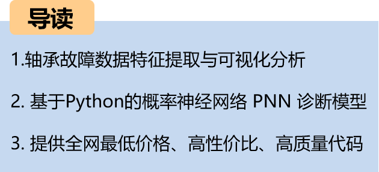
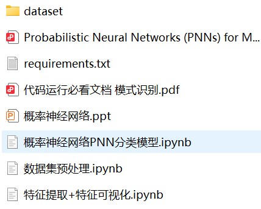
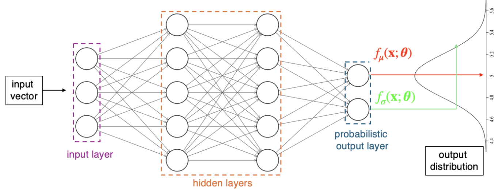
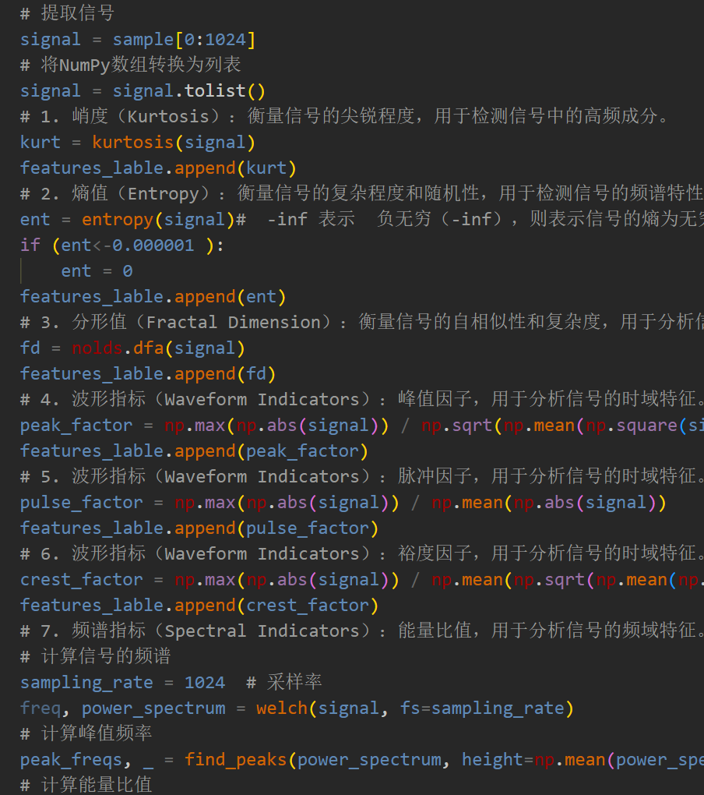
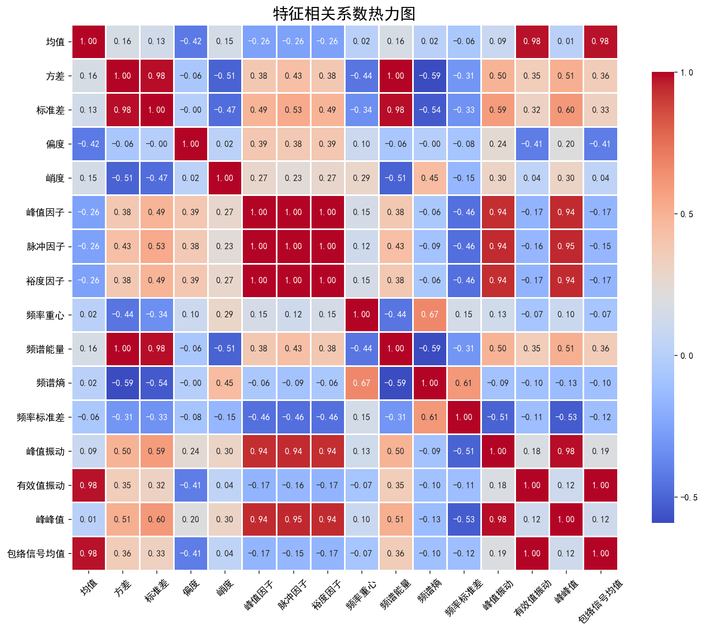
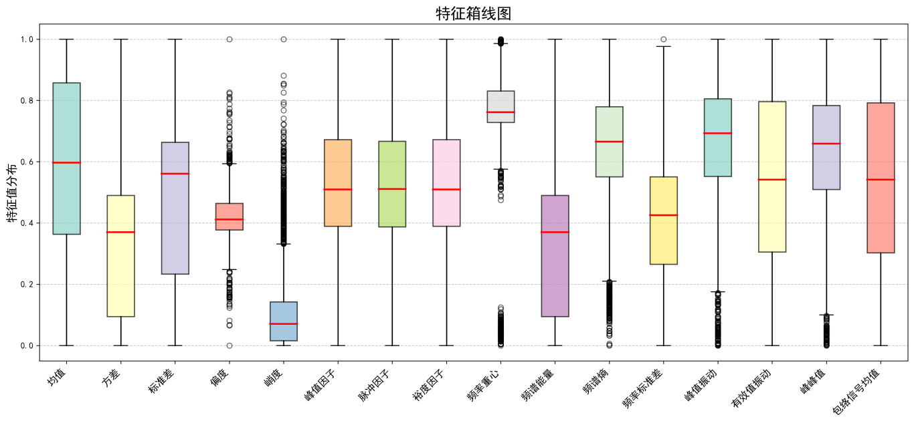
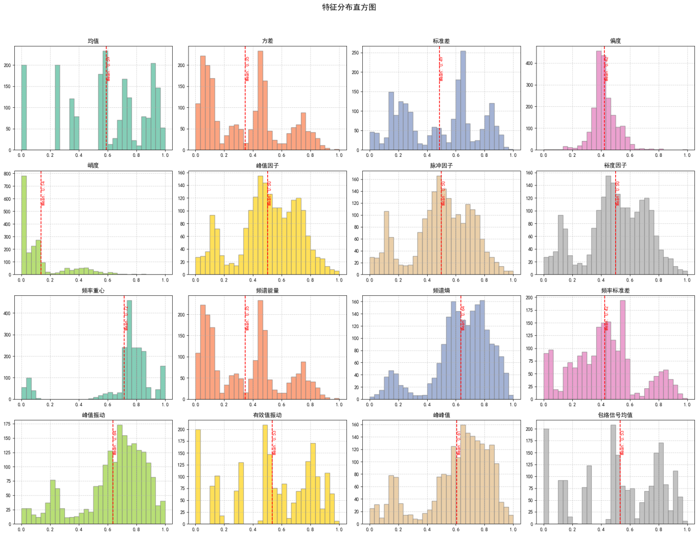
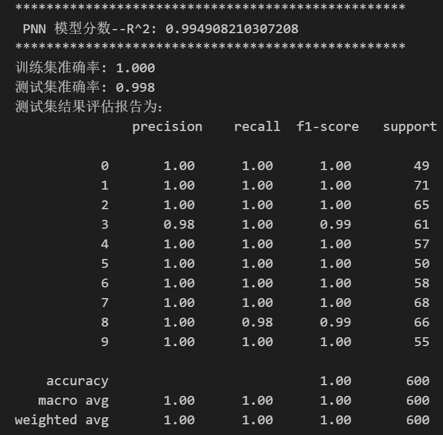
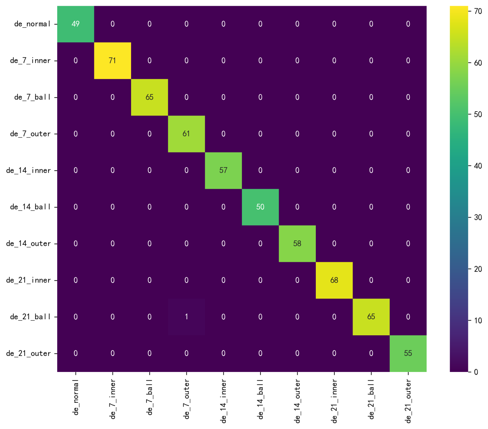
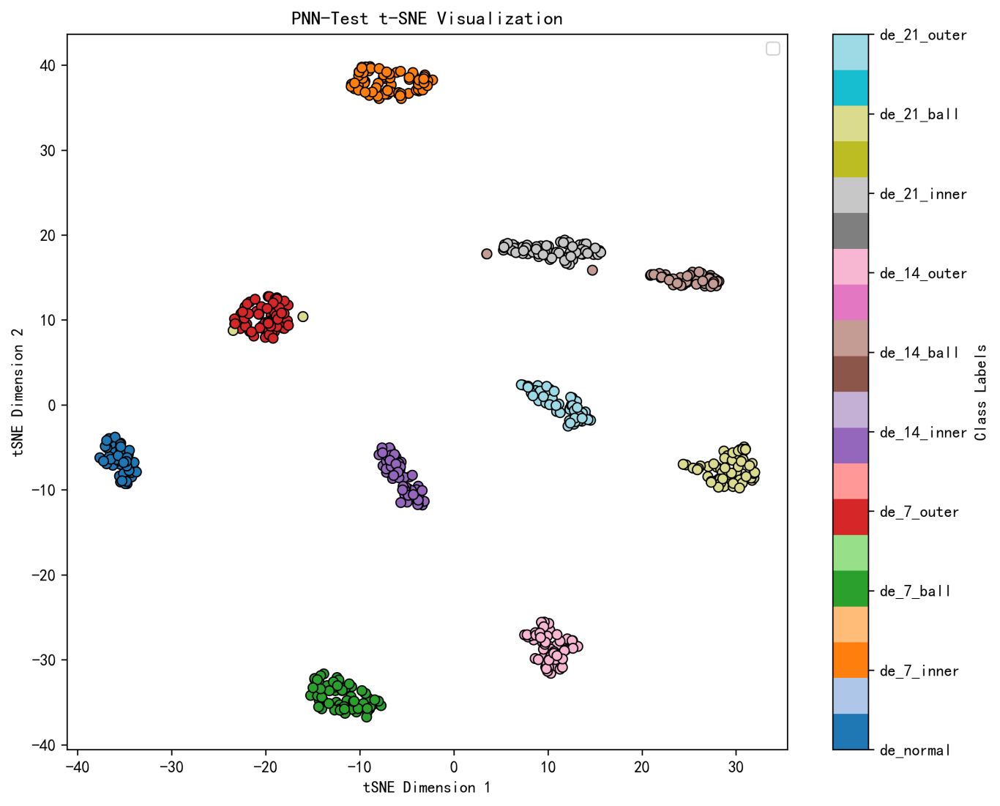

# Feature Extraction + Probabilistic Neural Network (PNN) Bearing Signal Fault Diagnosis Model

Introduction  
This issue combines the multi-scale feature extraction of vibration signals with the probability classification capability of PNN, proposing a "Multi-Feature Fusion - PNN Bearing Fault Diagnosis Model". This method extracts dozens of feature quantities from three aspects: time domain, frequency domain, and statistical complexity, to characterize the dynamic characteristics of bearing fault signals. It constructs high-dimensional feature vectors through normalization and feature fusion for input into PNN for training and recognition. Through experiments on the CWRU bearing dataset, the proposed method achieves excellent performance in classification accuracy and stability.  
●Dataset: Case Western Reserve University (CWRU) Bearing Dataset  
●Environmental framework: Python 3.11, PyTorch 2.1 and above versions can run  
●Accuracy: Test set 99%  
●Usage: Beginners, paper requirements, graduation design requirements  
●Code guarantee: Code comments are detailed and ready to run.  
1 Probability Neural Network PNN Introduction  
\t1.1 Model Introduction  
\tProbability Neural Network (PNN) is a type of feedforward neural network based on statistical pattern recognition, proposed by Donald F. Specht in 1990. It is a variant of Radial Basis Function (RBF) networks, which is based on Bayesian decision theory and Parzen window estimation for probability density estimation and classification. In simple terms, PNN does not learn weights through gradient descent like BP neural networks, but uses the distribution of samples to estimate the probability density function (PDF) of each class directly, and then classifies according to the principle of maximum posterior probability.  
\t  
\t1.2 Network Architecture Introduction  
\tPNN usually consists of four layers:  
\t (1)Input Layer
The input layer directly passes the feature vector of the input sample to the next layer. Each neuron corresponds to one dimension of the input features.
(2) Pattern Layer
The number of neurons in this layer equals the number of training samples, with each neuron corresponding to a single training sample. Each neuron computes the Gaussian kernel (probability density function) values between the input sample and its corresponding training sample, reflecting the similarity between the input sample and the training sample.
\t(3) Summation Layer
This layer aggregates the output of pattern layer neurons by category, calculating the probability density function estimates for each category.
(4) Output Layer
Select the category with the highest estimated probability as the classification result for the input sample.
\tPNN is essentially a sample-based nonparametric estimation method, where each training sample becomes a neuron.
2. Data Preprocessing for CWRU
2.1 Import Data
Refer to the previous article for preprocessing of fault classification 10, and the Case Western Reserve University bearing data set: Fault Classification Dataset 10.
2.2 Feature Extraction and Visualization
(1) Failure Signal Feature Extraction
\t\t  
Select metrics such as kurtosis, entropy, fractal values, waveform indicators, spectral indicators, frequency domain indicators, statistical features, and vibration characteristics to capture the multi-scale features of bearing signals, serving as the training and recognition for machine learning models.
(2) Visualization of fault signal characteristics
\t\t\t\t\t  
\t\t\t\t\t  
3. Fault Diagnosis Model Based on PNN
3.1 Define the network model, set parameters, and train the model
Accuracy rate of 99%, the classification effect of PNN with probability neural network is significant. It can extract important features from fault signal characteristics, and the effect is obvious.
3.2 Model Evaluation
(1) Accuracy, Precision, Recall, F1 Score
(2) Original Data t-SNE Feature Visualization
(3) t-SNE feature visualization after model training
\t\t  
Click to download: Complete original data, Python code
Previously Featured Content:
Rapid Document | Parallel Fault Diagnosis Model Based on 2D-SWinTransformer+1D-CNN-SENet
Significant update on bearing life prediction! New ensemble of CNN-BiGRU-Attention models + enriched visualization charts
Multimodal - Fault Diagnosis | The Big Core Convolution Opens a New Era in Vision!
Superior! Directly write in Zone One! Based on SSA+Informer-SENet Fault Diagnosis Model
Multi-source Information Fusion: Fault Diagnosis Model with Data Layer and Feature Layer Fusion!
! Gearbox Failure Diagnosis: Multimodal Innovative Model Based on MTF+Swin-Informer
Bearing Signal Fault Diagnosis Model Based on Multi-Scale Convolutional Neural Network (MSCNN-1D)
!Prediction of remaining lifespan of rolling bearings based on CNN-BiLSTM-KAN model
34 Classic Bearing Fault Diagnosis Models Collection | The King of Price-Performance on the Internet
END  
2. Friends who enjoy the content can follow, give the article a "like", share on social media or discuss in groups.

## Images

<!-- PAYMENT_BLOCK -->

## Get this dataset

- Payment link (Stripe): [Buy now](https://buy.stripe.com/3cs8yP7sY87d0vu9AB)
- Payment QR code: 

<!-- /PAYMENT_BLOCK -->
